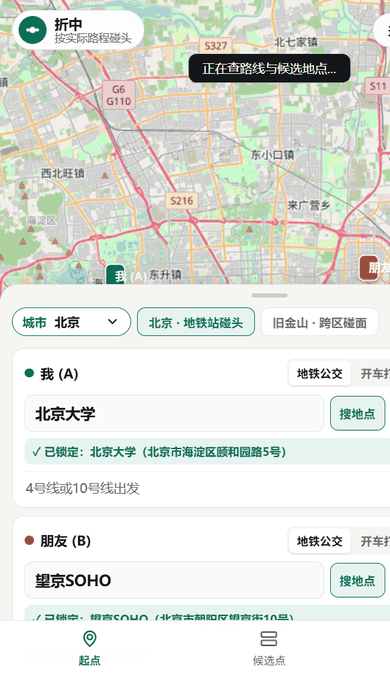

# Let's Meet

> 让我们碰面吧！

几个人从不同地方出发，想找个折中的地方碰头。这个工具按实际路程耗时来挑地点，选出来的结果可以是换乘地铁站、火车站、商场广场、公园，也可以是咖啡馆或餐厅，选好后直接拉起手机上的地图软件导航。

很多同类工具只把两个人的经纬度加起来除以二。真正在城里走一趟就知道，直线中点经常落在没法停车的路中间，或者一个人地铁直达、另一个人要倒三次车。这里把几何中点只当作粗略参考，真正用来排序的是每个人按各自交通方式（地铁公交、开车、骑行、步行）到达候选地点的实际耗时。

## 怎么算折中点

如果一个人坐地铁、一个人开车，程序会先按不同出行方式的城市平均速度把搜索范围往慢的一方偏一点，在沿线取三个搜索锚点召回候选地标或门店，再去算所有人到每个候选点的路程时间矩阵。

排序支持三种口径：

- 默认优先压低最远那个人的耗时，同时兼顾两边的时间差（`0.65 * max(t) + 0.35 * gap(t)`）。
- 也可以切成「双方耗时尽量接近」或者「所有人总路程最短」。
- 填了预计碰面时间后，会留出 5 分钟富余，倒推每个人几点出门。

自然语言条件交给大模型处理。比如一边写「坐 5 号线过去，出站好认」，另一边写「开车过去，要有地下车库」，模型会把这些零散要求转成检索词，并在路网筛出来的候选点里挑出更顺路的地方。

## 地图与模型配置

不填任何 API Key 也能直接跑：

- 地图默认走 OpenStreetMap（Photon 地标解析 + Nominatim 周边检索 + OSRM 路网测算）。如果你有高德开放平台 Web 服务 Key 或 Google Maps API Key，写进 `.env` 后会自动切过去；国内接口调用前会做 `WGS-84` 与 `GCJ-02` 坐标转换，避免导航偏几百米。
- 大模型支持免费通道顺延。没配付费 `LLM_API_KEY` 时，会依次尝试本地网页版转发端口（兼容 `Chat2API` 等工具代理的 Kimi、DeepSeek、通义千问、豆包网页版，其中 Kimi 也支持直接填浏览器 `kimi-auth` Cookie 直连）、系统环境变量里的免费模型（如智谱 `glm-4-flash`），最后兜底到免登录公共接口。

## 手机上怎么用

填好两边的出发地，点「找折中地点」。同名地点会列出来，核对区县街道后点「确定」再锁定，避免定位到另一个城市的同名点。选中候选点后可以直接拉起手机里的地图。



## 启动

需要 Python 3.11 或更高版本。

```powershell
# 运行测试
$env:PYTHONPATH="src"
pytest

# 启动本地服务并拉起 Cloudflare 公网 HTTPS 隧道
powershell -ExecutionPolicy Bypass -File .\scripts\start_mobile.ps1
```

脚本跑起来后会打印一个 `https://xxxx.trycloudflare.com` 地址。手机用蜂窝流量或微信都能直接点开，也能在 iOS Safari 或 Android Chrome 里「添加到主屏幕」当成独立应用使用。电脑本机调试可访问 `http://127.0.0.1:8780`，在「同屏与设置」页可以直接扫码或建房间发给同行人投票。

## 使用前注意

计算不在手机上跑。手机只打开网页、显示地图、读取定位和点选。搜地点、算路程、调高德、调大模型、保存房间，都发生在**启动服务的那台电脑**上。

- 电脑关机、休眠，或者 `8780` 端口上的进程停了，手机链接就打不开。同一 Wi-Fi 下的局域网地址也一样，电脑不在线就进不去。
- 公网地址是 Cloudflare 临时隧道，转发到这台电脑的 `127.0.0.1:8780`。隧道进程断了，旧的 `trycloudflare.com` 域名会失效。重新跑启动脚本通常会换成一个新域名，之前发出去的链接要重发。
- 打开链接的人共用这台电脑 `.env` 里的配置。高德 Key、大模型 Key 和模型名都写在启动它的那台机器上，不在手机上。国内地点走高德；没配 Google Maps Key 时，海外地点继续走 OpenStreetMap。
- 高德 Key 必须是开放平台里服务平台为 **Web服务** 的 Key。Web端 (JS API) 的 Key 会被拒绝，地点搜索和算路都不会切到高德。
- 搜地点和算耗时的快慢，主要看这台电脑访问高德、路网和大模型的网络，不看手机性能。地图底图是手机自己加载的。
- 房间存在这台电脑的内存和 `data/rooms.json` 里。换一台电脑启动，或者这个文件被删掉，旧的房间链接就失效。
